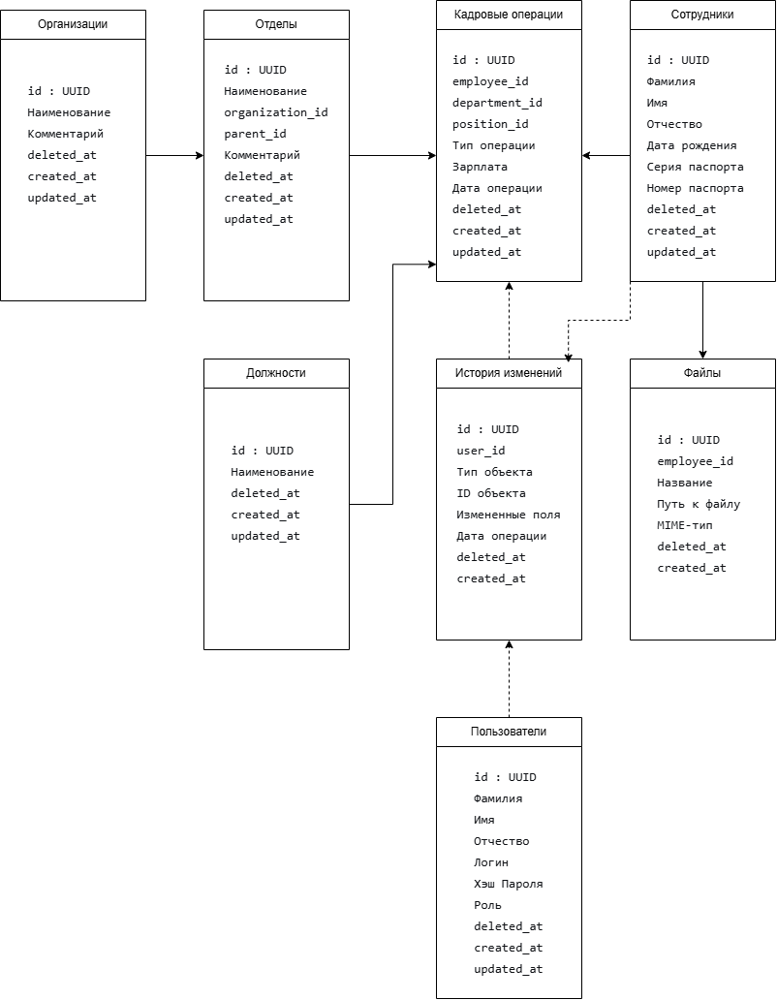

# Areal HR Test 2025

Веб-приложение для учета сотрудников в нескольких организациях.

## 📊 Схема базы данных

Схема БД спроектирована в Draw.io и включает в себя таблицы: Организации, Отделы, Должности, Сотрудники, Файлы, Кадровые операции, История изменений, Пользователи. Везде предусмотрено мягкое удаление (`deleted_at`).



## 🛠️ Инструментарий

| Компонент | Выбор |
| :--- | :--- |
| **ОС** | Windows 10/11 |
| **IDE** | WebStorm / IntelliJ IDEA |
| **Node.js** | 22 |
| **PostgreSQL** | 17 (запуск через Docker-контейнер) |

**Запуск PostgreSQL в Docker (для разработки):**
```bash
docker run -d --name hr-postgres -p 5432:5432 -e POSTGRES_PASSWORD=your_secure_password -e POSTGRES_DB=hr_db postgres:17
